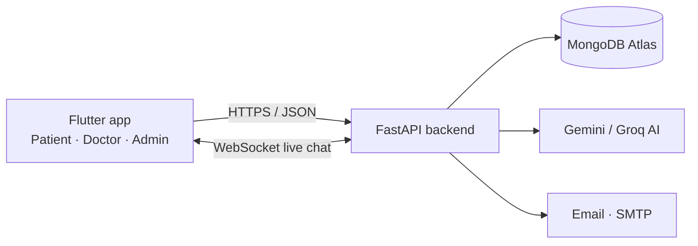

<div align="center">

# 🩺 AI Smart Healthcare

**AI-powered disease assessment, medicine help and online doctor consultations, built for Pakistan**

Flutter · FastAPI · MongoDB Atlas · Google Gemini / Groq · WebSocket

*Final Year Project (FYP)*

</div>

> ⚠️ **Health information only.** This app is a student project. It is **not** a medical device, is **not**
> clinically validated and does **not** replace a doctor. In an emergency call **1122**.

---

## What it does

One app with **three panels**. The app opens the right panel after login, depending on the account:

| Panel | Who | What they can do |
|---|---|---|
| 🧑 **Patient app** | Anyone who registers | Check symptoms with the AI, read reports and prescriptions, find medicines, labs and doctors, consult a doctor online, keep a health record |
| 👨‍⚕️ **Doctor panel** | Doctors who sign up **and are approved by the admin** | Receive consultation requests live, chat, confirm the fee from the payment screenshot, send prescriptions or ask the patient to visit the clinic |
| 🛡️ **Admin panel** | Administrator | Approve or reject doctor sign-ups, enable or disable any account, reset passwords, answer reported issues, see app totals |

### 1. AI Diagnosis & Medical Assistance
- **AI symptom checker:** asks follow-up questions, then gives possible causes, an urgency level (triage), tests to discuss, the right specialist, and over-the-counter options (generic names only, never doses). It uses a built-in knowledge base of 50 common diseases.
- **Emergency detection & SOS:** red-flag symptoms trigger an emergency screen with 1122 and the user's emergency contacts.
- **Medical report scanner:** upload a photo or PDF of a lab report. The AI reads each value, and code (not the AI) marks it low, normal or high using the printed range or standard adult ranges. Critical values are highlighted, and old and new reports can be compared.
- **Labs:** a nearby laboratory finder (PHC-registered labs across Punjab cities) and test price comparison (estimated prices are labelled).
- **Doctors:** specialists by city (Punjab government consultants list plus demo profiles, always labelled), links to Marham and oladoc, and **online consultation**.
- **AI health assistant:** text and voice chat in English, Urdu and Roman Urdu.

### 2. Online Doctor Consultation (live)
1. The chatbot recommends a specialist. The patient picks an approved doctor (green **Online** badge) and can share the AI symptom check.
2. The doctor accepts. The patient pays the fee with JazzCash, Easypaisa or a bank transfer and uploads the **payment screenshot**. The AI reads the amount and transaction ID to help the doctor check it.
3. The doctor confirms the payment, then sends a **prescription** (which becomes medicine reminders) or asks the patient to **visit the clinic** (address, timings, map; 1122 for emergencies).
4. Messages arrive **live over WebSocket**. Patients and doctors can report problems to the admin from the chat.

> The app never handles money. The patient pays in their own wallet or bank app and the doctor confirms receipt.

### 3. Medicine & Pharmacy
- **Prescription & handwriting reader:** take a photo with the camera and the AI transcribes each medicine line, with a confidence level for each. Unclear handwriting is marked, never guessed. The user checks it before anything is saved.
- **Medicine search:** about 470 brands and 200 salts (DRAP list), with **same-salt alternatives** (e.g. other brands of naproxen).
- **Drug interaction & safety checker**, and medicine information.
- **Nearby pharmacies:** pharmacies found online, plus DHQ/THQ hospital pharmacies, for every lab city.
- **Smart medicine reminders:** from a prescription photo or entered one by one (times, before or after food, number of days), with intake tracking and missed-dose alerts.

### 4. Health Records & Patient Care
- **My Health Record:** built automatically from symptom checks, reports, prescriptions, medicines, vitals, AI-suggested medicines and recommended doctors (with website links).
- **PDF export** locked with the user's login password (AES-256), plus a **QR share link** that expires after 24 hours. Urdu text is supported.
- **Future health risk:** diabetes (IDRS), blood pressure (ACC/AHA), heart, BMI (Asian cut-offs), kidney and anaemia, each with the reasons behind it.
- **Health trends:** charts with trend lines for BP, sugar, weight, heart rate and more.
- **Smartwatch over Bluetooth (BLE):** heart rate and battery, and vibration reminders for medicines (Android).

### 5. Mental Health (MindEase)
- Mood check-ins, PHQ-9 and GAD-7 screening (only with the user's consent), a supportive companion chat, breathing exercises, and crisis help.

---

## Tech stack

| Layer | Technology |
|---|---|
| Mobile / web app | Flutter 3 (Dart), Provider, go_router, web_socket_channel, flutter_blue_plus, image_picker, qr_flutter |
| Backend API | Python 3.11+, FastAPI, Pydantic v2, Uvicorn (REST + WebSocket) |
| Database | MongoDB Atlas (Motor async driver) |
| AI | Google Gemini (vision + text), with Groq as the fallback. Keys stay on the backend only |
| Security | bcrypt passwords, JWT access and refresh tokens (rotated), role-based access (patient / doctor / admin), rate limiting, consent records, audit log |
| PDF | ReportLab + pypdf (AES-256), DejaVu font with Urdu shaping |
| Tests | pytest with an in-memory MongoDB (144 backend tests); Flutter widget tests |

## Architecture



The app never talks to the database or the AI directly. Every key and secret lives in `backend/.env`.

## Project structure

```
├── backend/                 FastAPI server
│   ├── app/
│   │   ├── routers/         API endpoints (auth, assessments, reports, consultations, admin, issues, …)
│   │   ├── ai/              AI service, prompts, disease knowledge base, lab ranges
│   │   ├── health/          health record, risk scores, locked PDF
│   │   ├── realtime.py      WebSocket hub for live chat
│   │   └── db/ models/ core/
│   ├── data/                labs, doctors, medicines, pharmacies (CSV)
│   ├── scripts/             make_admin.py, data import helpers
│   └── tests/               pytest suite
├── frontend/                Flutter app
│   └── lib/
│       ├── screens/         patient screens, consult/ (doctor panel, chat), admin/
│       ├── services/        API repositories
│       └── core/            theme, router, config
└── RUN/                     START_BACKEND.bat · START_FRONTEND.bat · MAKE_ADMIN.bat
```

## Getting started

### Requirements
- Python 3.11+
- Flutter 3.22+
- A MongoDB Atlas cluster (free tier is fine)
- A Gemini API key (and optionally a Groq key)

### 1. Backend
```bash
cd backend
python -m venv .venv
.venv\Scripts\activate            # Windows  (macOS/Linux: source .venv/bin/activate)
pip install -r requirements.txt
copy .env.example .env            # then fill in MONGODB_URI, JWT_SECRET, GEMINI_API_KEY …
uvicorn app.main:app --reload --host 0.0.0.0 --port 8000
```
API docs: http://localhost:8000/docs. On Windows you can simply double-click **`RUN/START_BACKEND.bat`**.

> No Atlas yet? Set `USE_MEMORY_DB=true` in `.env` to try the app with an in-memory database (data is lost on restart).

### 2. Create the administrator (once)
```bash
cd backend
python scripts/make_admin.py      # or double-click RUN/MAKE_ADMIN.bat
```
You type the email and password; the password is stored only as a hash.

### 3. Flutter app
```bash
cd frontend
flutter pub get
flutter run -d chrome             # or an Android phone / emulator
```
Or double-click **`RUN/START_FRONTEND.bat`**. For a real phone on the same Wi-Fi:
`flutter run --dart-define=API_BASE_URL=http://<your-PC-IP>:8000`

### 4. Try the three panels
1. **Admin:** log in with the account from step 2.
2. **Doctor:** Register → *I am a doctor* → fill in the PMDC number, clinic, fee and payment account → wait. The admin approves it in **Admin panel → Doctors**.
3. **Patient:** register normally, run a symptom check, open the recommended doctor and tap **Consult online now**.

Tip: use a private (Incognito) window for the second account, because two accounts in one browser window log each other out.

## Tests
```bash
cd backend && python -m pytest -q
cd frontend && flutter test
```

## Data & honesty
- **Real data:** the PHC Punjab registered laboratories list, the Punjab government consultants list, the DRAP medicine list, and pharmacies found online. Each has a source column.
- **Demo data** (some doctor profiles, lab prices, phone numbers) is generated for the demo and **always labelled "Demo" or "approx."** in the app.
- The AI never prescribes or suggests doses. Only an approved doctor can send a prescription.

## Security & privacy
- No secrets in the app or in Git. `backend/.env` is ignored, and `.env.example` shows only the variable names.
- Passwords are hashed with bcrypt. Tokens are short-lived and refresh tokens are rotated.
- Mental health data is saved only with consent. The admin sees totals, names and emails, **never health data or chats**.
- Health record PDFs are encrypted with the user's own password.

---

<div align="center">
Made as a Final Year Project · For learning and demonstration only · Not for real medical use
</div>
